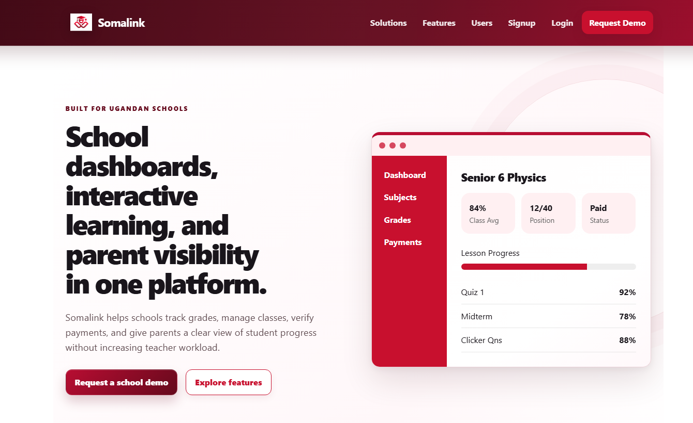

# Trevor Troy

I'm a software engineering undergraduate at Cal Poly Humboldt seeking a Summer 2027 software engineering or web development internship in the UK.

## Projects

**[Frame](https://github.com/troymwebesa-pixel/Frame)** is a full-stack app I built to identify films and TV shows from social links, save them to a shared watchlist and track playback progress.

**[SomaLink](https://somalink.online/somalink_landing_page/)** is a school management platform I co-founded and led engineering for. It brings attendance, assignments, quizzes and finance into one place for school staff.

I'm happy to give interviewers a live walkthrough of either app at a convenient time.

[LinkedIn](https://www.linkedin.com/in/trevor-troy/)
